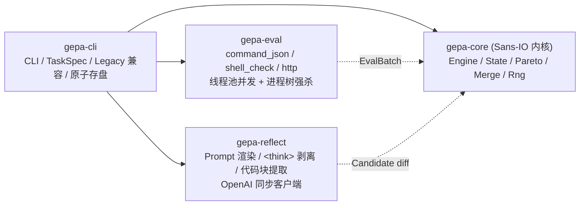
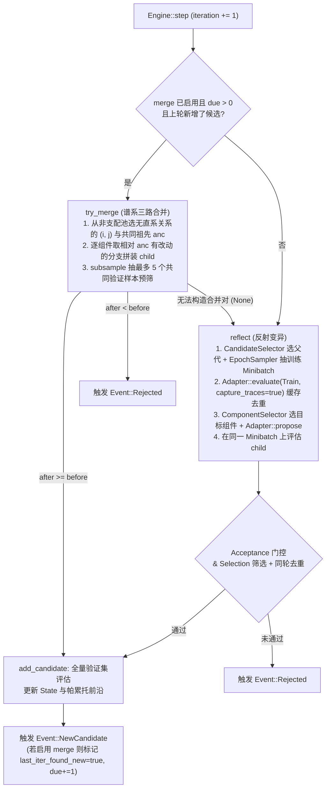

# gepa-rs 具体实现说明

本文面向贡献者与深度使用者，说明 `gepa-rs` 的模块划分、算法细节（对应 Python 版 `gepa 0.1.4` 的 `optimize_anything` 核心逻辑）、工程防坑实现以及源码索引。  
如需快速上手 CLI 与任务配置，请先阅读 [README.md](README.md)。

---

## 1. 架构总览：四层 Crate 拆分与职责边界

本项目采用 Rust Workspace（Edition 2024）拆分为四个职责正交的 Crate：



### 为什么 `gepa-core` 采用 Sans-IO 设计？

[gepa-core](gepa-core/Cargo.toml) 仅依赖 `serde` 与 `serde_json`，**零网络请求、零文件读写、零线程调度、零大模型客户端**。所有外部副作用全部收敛在 [Adapter](gepa-core/src/engine.rs#L37-L43) Trait 的三个方法上：

```rust
pub trait Adapter {
    fn evaluate(&mut self, candidate: &Candidate, split: Split, ids: &[DataId], capture_traces: bool) -> Result<EvalBatch>;
    fn propose(&mut self, parent: &Candidate, ids: &[DataId], eval: &EvalBatch, components: &[String]) -> Result<BTreeMap<String, String>>;
    fn on_event(&mut self, _event: &Event) {}
}
```

这样带来的直接收益：
1. **宿主无关**：上层可以是 `gepa-cli`，也可以直接把 `gepa-core` 嵌入任意 Rust Agent / 测试框架中，用内存函数替代进程和 HTTP 调用。
2. **数据零拷贝/低耦合**：`gepa-core` 不存储任何样本原文，只通过 `DataId`（`0..train_len` 与 `0..val_len` 下标）向 `Adapter` 请求评估。
3. **完全确定性与可快照**：整个搜索过程与外部 IO 隔离，序列化 `Engine` 即等于保存完整搜索状态。

### 在 Rust 中直接嵌入 `gepa-core` 示例

```rust
use std::collections::BTreeMap;
use gepa_core::strategies::Stop;
use gepa_core::{Adapter, Candidate, Config, DataId, Engine, EvalBatch, Split};
use serde_json::json;

struct MyAdapter;

impl Adapter for MyAdapter {
    fn evaluate(&mut self, c: &Candidate, _: Split, ids: &[DataId], traces: bool) -> gepa_core::Result<EvalBatch> {
        let prompt = &c["system_prompt"];
        let scores = ids.iter().map(|&id| if prompt.contains(&id.to_string()) { 1.0 } else { 0.0 }).collect();
        let feedback = if traces { ids.iter().map(|&id| json!({"want": id})).collect() } else { vec![] };
        Ok(EvalBatch { scores, feedback, ..Default::default() })
    }

    fn propose(&mut self, parent: &Candidate, _: &[DataId], eval: &EvalBatch, comps: &[String]) -> gepa_core::Result<BTreeMap<String, String>> {
        let comp = &comps[0];
        let mut next = parent[comp].clone();
        if let Some((fb, _)) = eval.feedback.iter().zip(&eval.scores).find(|(_, s)| **s < 1.0) {
            next.push_str(&format!(" {}", fb["want"]));
        }
        Ok(BTreeMap::from([(comp.clone(), next)]))
    }
}

fn run_example() -> gepa_core::Result<()> {
    let mut adapter = MyAdapter;
    let seed = Candidate::from([("system_prompt".into(), "init:".into())]);
    let cfg = Config {
        stop: Stop { max_metric_calls: Some(200), score_threshold: Some(1.0), ..Default::default() },
        ..Default::default()
    };
    let mut engine = Engine::new(cfg, seed, 4, 4, &mut adapter)?;
    engine.run(&mut adapter)?;
    let (best_idx, best_cand) = engine.best();
    println!("Best #{best_idx}: {best_cand:?}");
    Ok(())
}
```

---

## 2. 核心状态与帕累托前沿机制

相关源码：[gepa-core/src/state.rs](gepa-core/src/state.rs)、[gepa-core/src/pareto.rs](gepa-core/src/pareto.rs)。

### 2.1 `State` 数据结构

- `candidates: Vec<Candidate>`：所有被接受的候选；每个 `Candidate` 为 `BTreeMap<String, String>`（`组件名 -> 文本`），使用有序 `BTreeMap` 保证迭代和序列化顺序确定。
- `parents: Vec<Vec<usize>>`：候选谱系 DAG（变异子代有 1 个父代 `[p]`，合并子代有 2 个父代 `[p1, p2]`）。
- `val_scores: Vec<BTreeMap<DataId, f64>>`：每个候选在验证集各样本上的主分数。
- `objective_scores: Vec<Objectives>`：每个候选在各细分指标上的全验证集均值（由 `mean_objectives` 计算）。
- 三个前沿缓存表：
  - `front_val`: `DataId -> (最高分, 并列达到最高分的候选索引集合)`
  - `front_objective`: `MetricName -> (最高分, 候选索引集合)`
  - `front_cartesian`: `(DataId, MetricName) -> (最高分, 候选索引集合)`（仅当 `frontier_type == Cartesian` 时填充）

### 2.2 四种 `FrontierType` 对比

设验证集有 2 个样本（`Val(0)`、`Val(1)`），每个样本上报 2 个指标（`pass`、`speedup`）：

| `FrontierType` | 前沿键（`FrontierKey`）集合 | 物理意义 |
| :--- | :--- | :--- |
| `Instance` | `{Val(0), Val(1)}` | 只要某个候选在**任一题**上并列最高分，就占据该题前沿；防止擅长疑难样本的特化候选被高均值平庸候选淹没 |
| `Objective` | `{Objective("pass"), Objective("speedup")}` | 经典全局多目标前沿，分别保留总通过率最高、平均加速比最高的候选 |
| `Hybrid` *(默认)* | `{Val(0), Val(1), Objective("pass"), Objective("speedup")}` | `Instance ∪ Objective` 并集；`single` 模式只有 1 个样本时，靠 `Objective` 前沿仍可保留多维度优胜者 |
| `Cartesian` | `{Cartesian(0,"pass"), Cartesian(0,"speedup"), Cartesian(1,"pass"), Cartesian(1,"speedup")}` | 最细粒度的“样本 × 指标”笛卡尔积前沿 |

### 2.3 支配剪枝（`remove_dominated`）与加权采样（`sample_front`）

1. **支配剪枝（`pareto::remove_dominated`）**：
   - 将当前处于至少一条前沿上的所有候选按验证集平均分**从低到高**排序。
   - 依次检查候选 `y`：如果 `y` 所占有的**每一条前沿**上，都存在至少一个**未被淘汰的其他候选 `p != y`**（即 `y` 的所有强项都可以被别人替代），则将 `y` 标记为被支配并从所有前沿中移除。
   - 只要某条前沿由某个候选**独占**，该候选必定存活。
2. **加权采样（`pareto::sample_front`）**：
   - 将剪枝后的所有前沿集合的候选索引直接拼接为抽样池 `pool`（一个候选占了几条前沿，就在 `pool` 中出现几次），然后用均匀随机 `rng.choice(&pool)` 抽样。
   - **效果**：占据越多样本/指标榜首的非支配候选，被选为下一轮父代的概率严格成正比升高；若前沿为空则回退至验证集均分最高者（`argmax`）。

---

## 3. 单步进化循环详解（`Engine::step`）

相关源码：[gepa-core/src/engine.rs](gepa-core/src/engine.rs)、[gepa-core/src/strategies.rs](gepa-core/src/strategies.rs)、[gepa-core/src/merge.rs](gepa-core/src/merge.rs)。



### 3.1 采样与策略组件（`strategies.rs`）

- **父代选择（`CandidateSelector`）**：`Pareto`（默认，按剪枝前沿持有数抽样）、`CurrentBest`、`EpsilonGreedy { epsilon }`、`TopKPareto { k }`（仅在均分前 `k` 名内做前沿抽样）。
- **组件选择（`ComponentSelector`）**：`RoundRobin`（默认，每个候选独立记录 `next_component[parent]` 指针轮流改写单个组件，使不同分支有机会专精不同组件从而触发 Merge）或 `All`（一次改写全部组件）。
- **训练集分批（`EpochSampler`）**：每个 Epoch 对 `0..train_len` 洗牌；若不能整除 `minibatch_size`，从使用次数最少且洗牌靠后的样本中补齐尾批，保证每个样本每轮覆盖均衡且完全确定。
- **接受与筛选门控**：
  - `Acceptance`：`StrictImprovement`（默认，`after > before`）或 `ImprovementOrEqual`（`after >= before`）。
  - `Selection`：`All`（默认）、`Best`（保留增益最大的一个）或 `TopK { k }`；对选中子代按内容精确去重后再投入昂贵的全量验证集评估。

### 3.2 谱系三路合并（`merge.rs`）

原生交叉不调用大模型，仅当 `config.merge` 为 `Some` 且满足调度条件时触发：
1. **配对约束（`common_ancestor_pair`）**：从非支配池 `pareto::dominators` 中抽两个候选 `(i, j)`，要求两者互不为祖先，且存在共同祖先 `anc` 满足 `scores[anc] <= scores[i]`、`scores[anc] <= scores[j]`，并且至少存在一个组件只在一方被修改（`desirable`：`x != y && (a == x || a == y)`）。同时用 `triplets` 记录已试三元组防止重复。
2. **组件级拼装（`merge::attempt`）**：
   - 若仅 `i` 修改了某组件，取 `i`；若仅 `j` 修改了某组件，取 `j`；
   - 若双方都修改了同一组件，取验证集均分较高一方（平分则随机）；
   - 记录 `descriptions` 防止生成完全相同的合并组合；校验两者共同验证样本数 `>= val_overlap_floor`（`single` 模式只有 1 个样本，需设为 `1`）。
3. **分层子采样预筛（`merge::subsample`）**：从共同验证样本中按“1 胜 / 2 胜 / 平局”三个桶均匀抽取最多 5 个样本，评估 `child` 总分 `after >= max(sum(i), sum(j))` 才送入全量验证集。

---

## 4. 评估器（`gepa-eval`）的关键工程实现

相关源码：[gepa-eval/src/process.rs](gepa-eval/src/process.rs)、[command.rs](gepa-eval/src/command.rs)、[workspace.rs](gepa-eval/src/workspace.rs)、[http.rs](gepa-eval/src/http.rs)、[lib.rs](gepa-eval/src/lib.rs)。

1. **防管道死锁与跨平台进程树强杀（`process.rs`）**：
   - 在 Windows/Unix 上，单纯 `child.wait_with_output()` 或直接杀父进程会导致衍生孙进程继续持有 `stdout`/`stderr` 管道句柄而永久卡死。
   - `run_command_with_timeout` 为 `stdin` 写入、`stdout` 读取、`stderr` 读取分别启动独立线程并发排空管道，主线程每 `15ms` 轮询 `child.try_wait()`。
   - 一旦超时，先执行进程树强杀（Windows 下带 `CREATE_NO_WINDOW` 标志调用 `taskkill /F /T /PID <pid>`；Unix 下创建独立 `process_group(0)` 并向 `-<pid>` 进程组发送 `SIGKILL`），再 `wait()` 子进程并回收输出线程。
2. **`command_json` 的容错解析（`command.rs`）**：
   - 先尝试把整段 `stdout` 当作 JSON 对象解析；若外部工具前面输出了调试日志，则按行**逆序扫描**最后一个以 `{` 开头的合法 JSON 行。
   - 当超时或无有效 JSON 输出时，若配置了 `fail_score`（默认 `Some(0.0)`），则转为低分 + 诊断 `side_info` 返回，避免单题异常拖垮整个进化任务。
3. **`shell_check` 的隔离与安全保障（`workspace.rs`）**：
   - 每个评估样本使用独立临时目录（`TempWorkspace` RAII `Drop` 自动清理），复制 `template_dir` 时自动跳过 `.git` 与 `target`。
   - 严格校验 `targets` 与 `protect` 相对路径，拒绝绝对路径与 `..` 目录穿越。
   - 在写入候选文件前为 `protect` 路径建立字节快照；若 `targets` 试图覆盖受保护路径，或在 `check` 执行期间修改/删除了受保护文件，直接判 `0.0` 分并在 `side_info` 中记录 `violation`。
   - Windows 下通过 `CommandExt::raw_arg(format!("/d /s /c \"{script}\""))` 调用 `cmd.exe`，彻底避免 Rust 默认 MSVC 参数转义把命令中的双引号 `"` 破坏成 `\"`（导致 JSON 字符串解析失败）。
4. **保序线程池并发（`lib.rs` `run_parallel`）**：
   - 使用 `std::thread::scope` + `AtomicUsize` 原子下标领取任务，结果按原下标写入预分配槽位，保证 `EvalBatch` 的 `scores` / `objectives` / `feedback` 始终与传入 `ids` 严格对齐。

---

## 5. 反射器（`gepa-reflect`）的关键工程实现

相关源码：[gepa-reflect/src/template.rs](gepa-reflect/src/template.rs)、[extract.rs](gepa-reflect/src/extract.rs)、[lineage.rs](gepa-reflect/src/lineage.rs)、[client.rs](gepa-reflect/src/client.rs)、[lib.rs](gepa-reflect/src/lib.rs)。

1. **确定性反馈渲染与脱敏（`template.rs`）**：
   - Workspace 中为 `serde_json` 开启了 `preserve_order`（底层 `IndexMap`），使评估器返回的 `side_info` 键序在渲染成 Markdown 时保持原样，不会因哈希/字母重排破坏提示词一致性。
   - `hide_keys` 在渲染阶段过滤敏感字段（`multi` 模式默认屏蔽 `expected`、`Expected answer`、`answer`）。
   - `fence_for` 动态计算候选文本中的最长连续反引号长度，外层围栏自动取 `max_run + 1`（例如正文含 ```` ``` ```` 时外层自动升级为 ````` ```` `````），并在多组件模式下将其余组件以只读上下文一并展示。
2. **推理模型兼容与嵌套代码块提取（`extract.rs`）**：
   - `strip_thinking` 先剥离 Qwen3 / DeepSeek-R1 等模型输出的 `<think>...</think>` 块（未闭合标签保守保留原文，防止误删），避免提取到推理草稿中的代码片段。
   - `extract_code_block` 优先匹配 4+ 反引号外层围栏；若为常规三反引号围栏，则提取**第一个开围栏到最后一个闭围栏**之间的内容，确保 Markdown 提示词正文里自带的示例代码块不会被提前截断。
3. **同步客户端与企业内网代理旁路（`client.rs`）**：
   - 基于 `ureq 2.12` + `native-tls`（Windows 上直连系统 `schannel`，无需本地安装 CMake/OpenSSL C 库，且自动信任企业根证书）。
   - 对 HTTP `429`、`5xx` 及传输层瞬态错误自动按 `200ms * attempt` 退避重试；同时针对 SGLang `--reasoning-parser qwen3` 在推理耗尽 token 时返回 `content: null` 的情况给出明确报错。
   - `should_bypass_proxy` 识别 `localhost`、`127.*`、`::1` 及 RFC1918 私网段（`10.*`、`172.16–31.*`、`192.168.*`），显式关闭 `try_proxy_from_env` 避免企业代理拦截本地/内网推理机。
4. **全量谱系记忆与重复提案拦截（`lineage.rs`）**：
   - `Lineage` 记录所有已评估候选（包括被拒绝的子代）的得分、子指标与一行失败摘要，并在 `gepa-cli` 中随 `lineage.json` 持久化、`sync_state` 与 `State` 保持同步。
   - `render_context` 为当前父代按需拼装三路上下文（`Trial History & Rejected Edits`、`Best Accepted Branch`、`Sub-Metric Leaders`，相同榜首自动去重引用，总长度限 12 KB），并由 `Reflector::propose` 在评估前拦截与父代或已评估候选完全相同的提案（最多重问 2 次）。可通过 `PromptConfig::lineage = false` 关闭。

---

## 6. 断点续跑、原子存盘与旧配置兼容（`gepa-cli`）

相关源码：[gepa-cli/src/schema.rs](gepa-cli/src/schema.rs)、[legacy.rs](gepa-cli/src/legacy.rs)、[runner.rs](gepa-cli/src/runner.rs)、[main.rs](gepa-cli/src/main.rs)。

1. **完全可恢复的确定性状态**：
   - `gepa-core::rng::Rng` 内置可序列化的 `SplitMix64` 状态机，`State` 全量采用 `BTreeMap`/`BTreeSet`。
   - `runner.rs` 在初始化及每步 `step()` 后通过 `write_atomic`（写入同目录 `.tmp.<pid>` → `sync_all()` → `fs::rename` 原子替换）更新 `checkpoint.json`、`best_candidate.json` 与 `best/<comp>.txt`，并同步向 `stdout` 与 `run.log` 输出 UTF-8 NDJSON。
   - 重新运行同一 `--run-dir` 时，反序列化 `checkpoint.json` 后仅覆盖新的 `stop` 上限（如追加 `--budget`），即可无缝接续随机数流与 Epoch 采样位置；若已满足停止条件则直接进入 test 评测并输出 `summary.json`。
2. **数据模式与单池自动切分（`schema.rs`）**：
   - 相对路径统一以 `task.json` 所在目录为基准解析（含 `seed_files`、`dataset.*`、`evaluator.cwd`、`template_dir`、`task_dir`、`stop_file`）。
   - 当 `mode == generalize` 且使用 `dataset.pool` 时，用固定种子 `Rng::new(0)` 洗牌：有 `test` 时按 50/50 划分为 `train`/`val`，无 `test` 时按 1/3 划分为 `train`/`val`/`test`。
3. **旧版任务兼容（`legacy.rs`）**：
   - `is_legacy_json` 检测缺少 `"evaluator"` 且包含 `"score"`/`"check"`/`"candidate"` 的旧版配置，自动完成字段映射（含数组形式 `"test": ["test.jsonl"]`、`stop_at_score`、`check_timeout` 与 `candidate: "file"` 缺省从 `<workspace>/<target>` 读取 seed）。

---

## 7. 源码文件速查索引

| Crate | 文件 | 核心内容 |
| :--- | :--- | :--- |
| `gepa-core` | [src/lib.rs](gepa-core/src/lib.rs) | 公共导出与 `Error`/`Result` 类型 |
| `gepa-core` | [src/engine.rs](gepa-core/src/engine.rs) | `Adapter` Trait、`Config`、`Event`、`Engine` 主循环与防御性校验 |
| `gepa-core` | [src/state.rs](gepa-core/src/state.rs) | `Candidate`、`State`、`FrontierType` 四种帕累托前沿维护 |
| `gepa-core` | [src/pareto.rs](gepa-core/src/pareto.rs) | `remove_dominated` 支配剪枝与 `sample_front` 前沿加权采样 |
| `gepa-core` | [src/merge.rs](gepa-core/src/merge.rs) | 共同祖先搜索、组件级三路合并与 `subsample` 分层预筛 |
| `gepa-core` | [src/strategies.rs](gepa-core/src/strategies.rs) | `CandidateSelector`、`ComponentSelector`、`EpochSampler`、`Acceptance`、`Selection`、`Stop` |
| `gepa-core` | [src/rng.rs](gepa-core/src/rng.rs) | 可序列化 `SplitMix64` 确定性伪随机数生成器 |
| `gepa-core` | [tests/engine.rs](gepa-core/tests/engine.rs) | 端到端确定性、快照回放、支配剪枝与合并单测 |
| `gepa-eval` | [src/lib.rs](gepa-eval/src/lib.rs) | `EvalConfig`、`Evaluator`、`AnyEvaluator` 与 `run_parallel` 线程池 |
| `gepa-eval` | [src/process.rs](gepa-eval/src/process.rs) | 跨平台管道并发排空与超时进程树强杀 |
| `gepa-eval` | [src/command.rs](gepa-eval/src/command.rs) | `command_json` 子进程 JSON 协议与逆序行解析 |
| `gepa-eval` | [src/workspace.rs](gepa-eval/src/workspace.rs) | `shell_check` 隔离工作区、`protect` 快照校验与 `GEPA_SCORE(S)` 解析 |
| `gepa-eval` | [src/http.rs](gepa-eval/src/http.rs) | `http` 同步评估客户端与内网代理绕过 |
| `gepa-reflect` | [src/lib.rs](gepa-reflect/src/lib.rs) | `Reflector` 门面与反射单测 |
| `gepa-reflect` | [src/template.rs](gepa-reflect/src/template.rs) | `PromptConfig`、`format_feedback` 有序渲染与 `hide_keys` |
| `gepa-reflect` | [src/lineage.rs](gepa-reflect/src/lineage.rs) | 全量谱系评估记忆、紧凑 Diff 与三合一反思上下文渲染 |
| `gepa-reflect` | [src/extract.rs](gepa-reflect/src/extract.rs) | `strip_thinking` 与嵌套反引号代码块提取 |
| `gepa-reflect` | [src/client.rs](gepa-reflect/src/client.rs) | `LmClient`、`LmConfig`、`OpenAiClient` 重试与代理旁路 |
| `gepa-cli` | [src/main.rs](gepa-cli/src/main.rs) | `clap` CLI 子命令与 `init` 脚手架生成 |
| `gepa-cli` | [src/schema.rs](gepa-cli/src/schema.rs) | `TaskSpec` v1、`LoadedTask` 路径解析与数据集切分 |
| `gepa-cli` | [src/legacy.rs](gepa-cli/src/legacy.rs) | `gepa_plugin` 旧版任务自动识别与 `convert` 转换 |
| `gepa-cli` | [src/runner.rs](gepa-cli/src/runner.rs) | `CliAdapter`、原子存盘、`run` / `status` / `stop` 实现 |
| `gepa-cli` | [tests/cli.rs](gepa-cli/tests/cli.rs) | `init` / `convert` / `run` / `resume` / `status` / `stop` 集成测试 |
