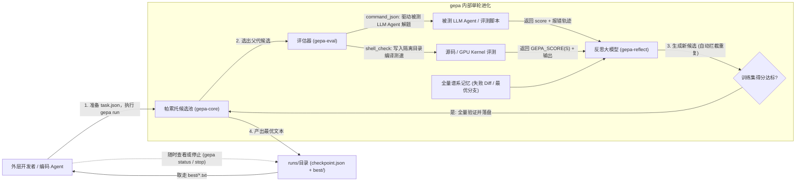

# gepa-rs 使用指南

`gepa` 是一个单文件跨平台进化优化器，通过“真实评估 → 大模型反思改写 → 帕累托留优”的闭环，自动改进 **LLM Agent 的系统提示词（Prompt）** 或 **源码 / GPU Kernel 文件**。它不依赖 Python `gepa` / `litellm`，也不绑定特定 Agent 工具。

## 全流程：如何配合 LLM Agent 使用



- 让你的编码 Agent 自动接管配置与调优：[Agent.md](Agent.md)
- 实现原理、算法细节与源码索引：[IMPLEMENTATION.md](IMPLEMENTATION.md)

---

## 1. 直接使用（已有编译好的 `gepa` 可执行文件）

如果你手里已经有了编译好的 `gepa`（Windows 下为 `target/release/gepa.exe`），推荐直接交给编码 Agent（Claude Code、Cursor、Antigravity 等）跑：

### 方式一：一句话交给编码 Agent 自动完成（推荐）

把 `@Agent.md` 和 `gepa` 路径交给你的编码 Agent，然后只需在对话框里说清楚 **① 数据在哪、② 怎么评估打分、③ 反思大模型接口是什么**，例如：

> 请阅读 `@Agent.md`，用 `gepa` 帮我优化系统提示词。  
> 数据在 `data/train.jsonl` 和 `data/val.jsonl`；评估时把候选作为 system prompt 发给 `http://127.0.0.1:8080/v1`（`<model-name>`）运行我的判分逻辑；反思模型也用这个地址，先测基线再跑 50 预算。

编码 Agent 会按 [Agent.md](Agent.md) 自动编写评估桥接脚本和 `task.json`、先跑单样本与 `--budget 0` 预检、后台启动优化，最后把最优结果交付给你。

### 方式二：直接运行现成 `task.json`

```bash
# 启动或断点续跑（中断后重跑同一命令自动从 checkpoint 恢复；加 --fresh 从头重跑）
./target/release/gepa run task.json --run-dir runs/my_task --budget 50

# 随时查看进度 / 优雅停止（最优产物输出在 runs/my_task/best/ 与 summary.json）
./target/release/gepa status runs/my_task
./target/release/gepa stop runs/my_task
```

### 方式三：作为 Agent Skill 插件安装（免手动 `@Agent.md`）

将 Release 压缩包解压到 `~/.gemini/config/plugins/`（Antigravity）、`~/.claude/plugins/`（Claude Code）或项目 `.agents/skills/gepa/`，即可自动注册 `gepa` Skill 与内置的 `bin/gepa` 二进制，无需每次手动 `@Agent.md`。

---

## 2. 如果你想自己搭建与手动配置

### 2.1 从源码编译与四步运行

前置条件：Rust 工具链（`cargo`），以及任意 OpenAI 兼容聊天接口（本地/内网 SGLang、vLLM 或云端 API；仅跑 `--budget 0` 基线时无需大模型）。

```bash
# 0. 编译单文件可执行程序 target/release/gepa（Windows 为 gepa.exe）
cargo build --release -p gepa-cli

# 1. 生成任务模板（eval 可选 command-json / shell-check / http）
./target/release/gepa init demo --mode generalize --eval command-json -o task.json

# 2. 先测初始基线（不调用反思模型）
./target/release/gepa run task.json --run-dir runs/demo --budget 0

# 3. 启动优化
./target/release/gepa run task.json --run-dir runs/demo --budget 50

# 4. 随时查看进度或优雅停止
./target/release/gepa status runs/demo
./target/release/gepa stop runs/demo
```

### 2.2 两类最小 `task.json` 模板

#### 模板 A：优化 LLM Agent 提示词（`command_json`）

```json
{
  "schema_version": 1,
  "mode": "generalize",
  "seed": { "system_prompt": "You are a careful coding assistant." },
  "dataset": { "train": "train.jsonl", "val": "val.jsonl" },
  "evaluator": {
    "type": "command_json",
    "program": "python",
    "args": ["-X", "utf8", "eval_agent.py"],
    "cwd": ".",
    "concurrency": 2,
    "timeout_secs": 300
  },
  "reflector": {
    "lm": { "base_url": "http://127.0.0.1:8080/v1", "model": "default" },
    "objective": "Maximize pass rate and speed."
  },
  "engine": { "minibatch_size": 3, "stop": { "max_metric_calls": 50 } }
}
```

- **引擎写给 `stdin`**：`{"candidate": {"system_prompt": "..."}, "split": "train", "id": 0, "example": {...}, "capture_traces": true}`。
- **脚本写回 `stdout`**（整段或最后一行以 `{` 开头的 JSON）：`{"score": 1.0, "objectives": {"pass": 1.0, "speedup": 1.2}, "side_info": {"Error": "..."}}`。

#### 模板 B：直接优化代码 / GPU Kernel 文件（`shell_check`）

```json
{
  "schema_version": 1,
  "mode": "single",
  "seed_files": { "code": "solve.py" },
  "evaluator": {
    "type": "shell_check",
    "template_dir": ".",
    "targets": { "code": "solve.py" },
    "protect": ["check.py"],
    "check": "python check.py",
    "timeout_secs": 60
  },
  "reflector": {
    "lm": { "base_url": "http://127.0.0.1:8080/v1", "model": "default" },
    "objective": "Pass all checks as fast as possible."
  },
  "engine": { "minibatch_size": 1, "stop": { "max_metric_calls": 20 } }
}
```

- `protect` 里的文件会被快照校验，候选覆盖或脚本篡改直接记 `0` 分。
- `check` 在 `stdout` 打印 `GEPA_SCORE=<浮点数>` 作为主分（不打印则退出码 `0` 记 `1.0`，非 `0` 记 `0.0`）；可选打印 `GEPA_SCORES={"acc": 1.0, "speed": 1.5}` 维护多目标帕累托前沿。

### 2.3 常用配置速查

- **数据模式（`mode`）**：`single`（单题调优，无需题库）、`multi`（同题库搜索并自动隐藏 `expected` / `Expected answer` / `answer` 防抄答案）、`generalize`（默认，`train`+`val` 或只填 `pool` 自动切分）。
- **多组件分块与交叉**：在 `seed` / `seed_files` 放多个 key 即按轮询改写；在 `engine` 加 `"merge": {"max_invocations": 5, "val_overlap_floor": 1}` 可开启共同祖先三路合并。
- **全量谱系记忆（默认开启）**：反思自动附带历史失败 Diff、跨分支最优与子指标榜首，并拦截重复提案；设 `reflector.lineage: false` 可关闭。
- **旧版 `gepa_plugin` 迁移**：直接 `gepa run old_task.json` 自动兼容，或 `gepa convert old_task.json -o task.json` 导出新格式。
- **鉴权与代理**：API Key 依次读取 `reflector.lm.api_key` → `GEPA_LM_API_KEY` → `OPENAI_API_KEY`；访问 `localhost`、`127.*`、`10.*`、`172.16–31.*`、`192.168.*` 自动绕过系统代理。
- **运行产物**：`runs/<name>/best/*.txt`（最优文本）、`summary.json`、`checkpoint.json`、`lineage.json`、`run.log`。

---

## License

MIT
