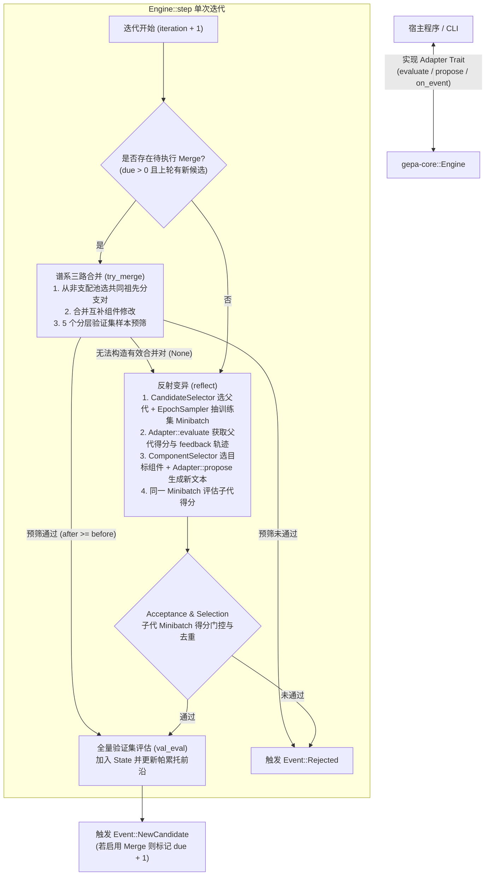

# gepa-rs

`gepa-rs` 是 **GEPA（Genetic-Pareto Reflective Evolution，反射式遗传帕累托优化）** 算法的 Rust 移植实现（对应 Python 版 `gepa 0.1.4` 的核心搜索引擎与 `optimize_anything` 默认策略）。

它用于优化由一个或多个命名文本组件构成的目标产物（如 System Prompt、Agent 多阶段指令、代码片段等），结合 **执行轨迹反射变异（Reflective Mutation）**、**多维帕累托前沿维护（Pareto Frontier）** 与 **谱系三路合并（Genealogical Merge）**，在有限的评估预算内高效搜索最优文本组合。

---

## 核心特性

- **Sans-IO 无副作用内核（Functional Core, Imperative Shell）**：核心库 `gepa-core` **零网络、零文件 IO、零内置大模型依赖**（仅依赖 `serde` 与 `serde_json`）。所有外部交互（运行评估、调用大模型生成新文本、事件监听）全部收敛于单一的 `Adapter` Trait。
- **多维帕累托前沿保留专长候选**：不止看验证集平均分，支持按样本（`Instance`）、按指标（`Objective`）、混合（`Hybrid`）及笛卡尔积（`Cartesian`）维护帕累托前沿，避免局部专长型候选在早期被均值淘汰。
- **基于共同祖先的谱系合并（3-Way Merge）**：追踪所有候选的演化有向无环图（DAG），自动寻找非支配池中具有共同祖先且修改互补的两个分支进行组件级三路合并，并通过分层子采样快速验真。
- **完全确定性与原生断点续跑（Checkpoint / Resume）**：全量采用 `BTreeMap` / `BTreeSet` 消除哈希随机性，内置可序列化的 `SplitMix64` 随机数生成器。任意时刻将 `Engine` 序列化为 JSON 即为完整快照，反序列化后可无缝恢复相同的随机数流与搜索轨迹。

---

## Workspace 目录与模块状态

本项目采用 Rust Workspace（Edition 2024）组织，划分为四个职责解耦的 Crate：

```text
gepa-rs/
├── gepa-core/       # [已完成] 纯算法核心引擎：状态、帕累托前沿、反射循环、谱系合并、策略与停止条件
│   ├── src/
│   │   ├── lib.rs         # 公共导出与错误类型定义
│   │   ├── engine.rs      # Engine 主循环、Adapter 接口、反射变异与合并调度
│   │   ├── state.rs       # Candidate/State 数据结构与四类帕累托前沿更新
│   │   ├── pareto.rs      # 支配剪枝 (remove_dominated) 与按前沿持有数加权采样
│   │   ├── merge.rs       # 共同祖先搜索、组件级三路合并与分层验证集子采样
│   │   ├── strategies.rs  # 父代选择、组件轮询、Epoch 分批采样、接受门控与停止器
│   │   └── rng.rs         # 可序列化的确定性 SplitMix64 伪随机数生成器
│   └── tests/
│       └── engine.rs      # 端到端收敛、确定性快照回放、支配剪枝与合并单元测试
├── gepa-reflect/    # [规划中/骨架] Adapter::propose 默认实现：渲染反馈模板并调用 OpenAI 兼容接口
├── gepa-eval/       # [规划中/骨架] Adapter::evaluate 默认实现：子进程 JSON stdin/stdout 与 HTTP 评估器
└── gepa-cli/        # [规划中/骨架] `gepa` 命令行入口：串联 eval + reflect，输出 NDJSON 事件流并逐步存盘
```

---

## 系统架构与单步演化流程



---

## 核心概念说明

### 1. 数据所有权与 `Candidate`
- **宿主持有原始数据**：`gepa-core` 不存储具体的训练/验证文本，仅通过 `DataId`（`0..train_len` 与 `0..val_len` 下标）向 `Adapter` 请求评估，保持引擎状态轻量且与业务数据结构解耦。
- **多组件候选（`Candidate`）**：定义为 `BTreeMap<String, String>`（`组件名 -> 文本内容`），既支持单 Prompt 优化，也支持多模块 Agent 系统按轮询（`RoundRobin`）或全量（`All`）方式协同演化。

### 2. `Adapter` 宿主接口
接入任意评估环境与大模型只需实现 `gepa_core::Adapter`：
- `evaluate(&mut self, candidate, split, ids, capture_traces) -> Result<EvalBatch>`：在指定的 `Train` 或 `Val` 子集下标上运行候选，返回每个样本的主得分 `scores`、可选多目标指标 `objectives` 以及用于反射的诊断信息 `feedback`（仅当 `capture_traces == true` 时需要）。
- `propose(&mut self, parent, ids, eval, components) -> Result<BTreeMap<String, String>>`：根据父代在训练 Minibatch 上的运行反馈 `eval`，重写 `components` 指定的组件文本。
- `on_event(&mut self, event)`（可选）：监听 `IterationStart`、`NewCandidate`、`Rejected`、`Skipped`、`Error` 事件。

### 3. 四种帕累托前沿模式（`FrontierType`）
| 模式 | 前沿维度 | 适用场景 |
| :--- | :--- | :--- |
| `Instance` | 每个验证集样本 `Val(id)` 独立一个前沿 | 防止擅长疑难样本的特化候选被高均值平庸候选淘汰 |
| `Objective` | 每个评估指标 `Objective(name)` 独立一个前沿 | 多目标权衡（如准确率 vs. 响应长度/延迟） |
| `Hybrid` *(默认)* | `Instance` ∪ `Objective` 并集 | 兼顾单样本特化能力与多指标平衡 |
| `Cartesian` | `Cartesian(id, metric)` 样本 × 指标乘积 | 极细粒度的样本级多指标前沿追踪 |

### 4. 停止条件（`Stop`）
为防止无限消耗预算，`Engine::new` 强制要求至少配置一项停止条件（任一满足即停止）：
- `max_metric_calls`：最大评估调用次数预算
- `max_iterations`：最大迭代轮数
- `max_candidates`：最多接受的候选总数
- `score_threshold`：验证集最优均分达到阈值即停
- `max_stale_iterations`：连续多少轮未刷新验证集最高均分即停（早停）
- `timeout_secs`：墙钟超时秒数
- `stop_file`：检测到指定路径文件存在时优雅退出

---

## 快速开始

### 构建与运行测试

```bash
cargo test --workspace
```

### 在 Rust 代码中嵌入 `gepa-core`

```rust
use std::collections::BTreeMap;
use gepa_core::strategies::Stop;
use gepa_core::{Adapter, Candidate, Config, DataId, Engine, EvalBatch, Event, Split};
use serde_json::json;

struct MyAdapter;

impl Adapter for MyAdapter {
    fn evaluate(
        &mut self,
        candidate: &Candidate,
        _split: Split,
        ids: &[DataId],
        capture_traces: bool,
    ) -> gepa_core::Result<EvalBatch> {
        let prompt = &candidate["system_prompt"];
        let scores: Vec<f64> = ids
            .iter()
            .map(|&id| if prompt.contains(&id.to_string()) { 1.0 } else { 0.0 })
            .collect();
        let feedback = if capture_traces {
            ids.iter().map(|&id| json!({ "missing_id": id })).collect()
        } else {
            vec![]
        };
        Ok(EvalBatch { scores, feedback, ..Default::default() })
    }

    fn propose(
        &mut self,
        parent: &Candidate,
        _ids: &[DataId],
        eval: &EvalBatch,
        components: &[String],
    ) -> gepa_core::Result<BTreeMap<String, String>> {
        let comp = &components[0];
        let mut next_text = parent[comp].clone();
        if let Some((fb, _)) = eval.feedback.iter().zip(&eval.scores).find(|(_, s)| **s < 1.0) {
            next_text.push_str(&format!(" {}", fb["missing_id"]));
        }
        Ok(BTreeMap::from([(comp.clone(), next_text)]))
    }

    fn on_event(&mut self, event: &Event) {
        println!("{event:?}");
    }
}

fn main() -> gepa_core::Result<()> {
    let mut adapter = MyAdapter;
    let seed = Candidate::from([("system_prompt".into(), "init:".into())]);
    let config = Config {
        stop: Stop {
            max_metric_calls: Some(200),
            score_threshold: Some(1.0),
            ..Default::default()
        },
        ..Default::default()
    };

    // 初始化引擎（会对 seed 执行一次全量验证集评估）
    let mut engine = Engine::new(config, seed, /*train_len=*/ 4, /*val_len=*/ 4, &mut adapter)?;

    // 逐步执行并在每步后支持 JSON 序列化存档
    while !engine.should_stop() {
        engine.step(&mut adapter)?;
        let _checkpoint_json = serde_json::to_string(&engine)?;
    }

    let (best_idx, best_candidate) = engine.best();
    println!("Best #{best_idx}: {best_candidate:?}");
    Ok(())
}
```

---

## License

MIT
